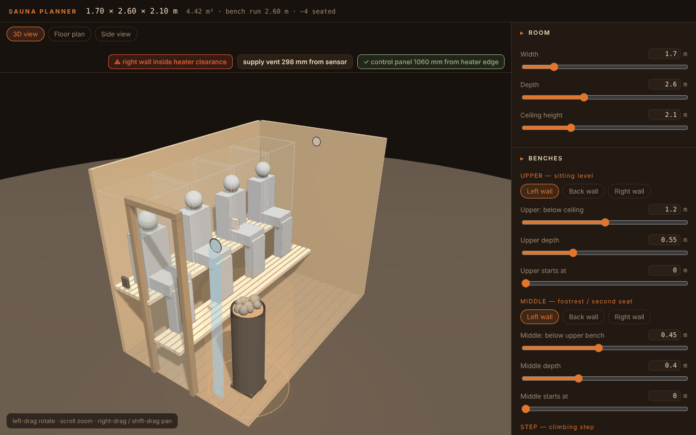
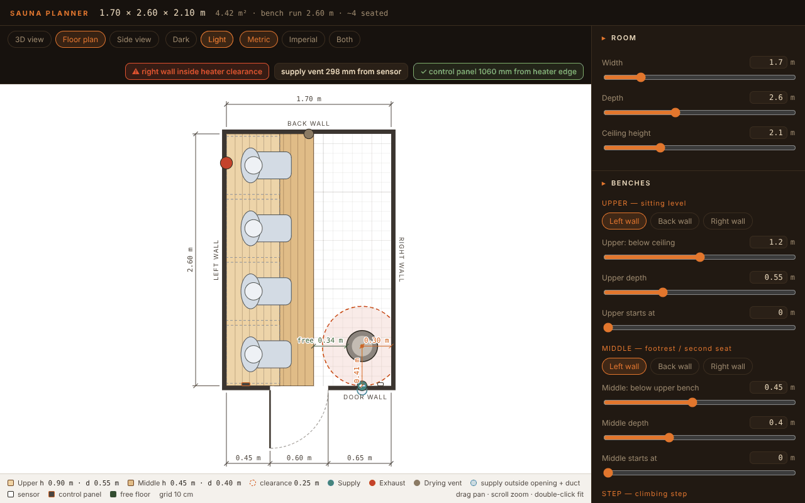
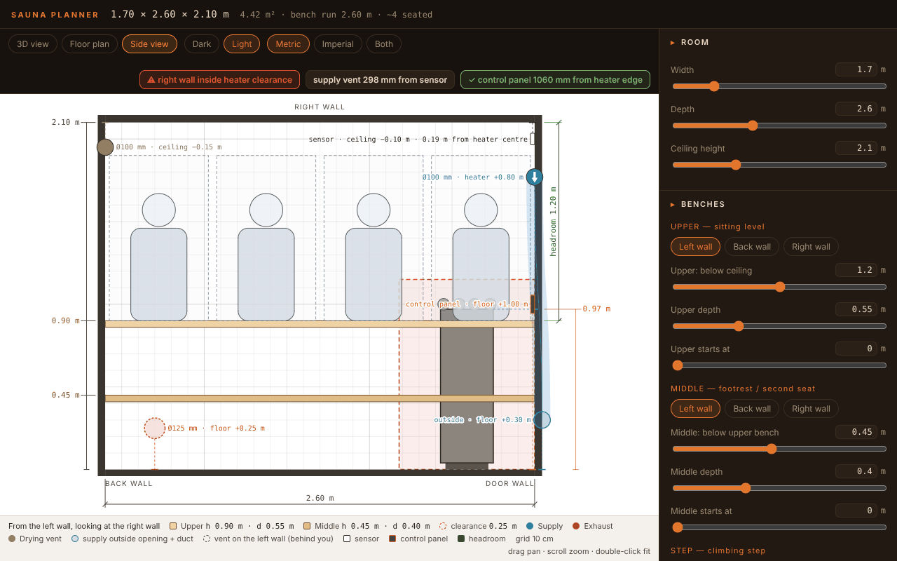

# Sauna Planner

Plan a small sauna room in the browser. You can orbit a 3D model, or switch to a dimensioned floor plan or side view. All three are drawn from the same settings.



## Features

- **Room and door:** width, depth and ceiling height, plus the door's position and width. The door wall gets a chain dimension that adds up to the room width.
- **Benches:** up to three tiers (upper, middle and step) on the left, back and right walls, so you can build L and U layouts. Each tier has its own depth and start position. Heights are set the way you'd build them: the upper bench from the ceiling, the middle bench below the upper, and the step from the floor. Exposed bench ends can have rails.
- **Capacity:** shows seated people and how much bench width each one takes.
- **Heater:** Harvia Cilindro, HUUM Drop or Harvia Spirit (385 × 335 × 750 mm, with the optional HSP3M safety railing), on any wall. A safety-clearance zone shows around it, and you get a warning if a bench, wall or the ceiling is inside it.
- **Ventilation:**
  - Three round vents, each measured from its own reference: supply from the heater top, exhaust from the floor, and drying vent from the ceiling.
  - The supply runs through a duct to a lower opening on the outside of the wall.
  - The supply also gets an arrow for the airflow direction.
- **Sensor and control panel:** place the heater's temperature sensor and its control panel. The planner shows the sensor's distance to the supply vent. The control panel can sit at most 1.2 m up, and you get a warning if it's less than 1 m from the heater's edge.
- **2D drawings:** fully dimensioned, with pan and zoom. They come in a dark theme for the screen and a light one for printing, in metric, imperial, or both.
- **Save and load:** export all settings as text, and paste the text back in to restore them.

| Floor plan | Side view |
| --- | --- |
|  |  |

## Running it

```sh
npm install
npm run dev
```

`npm run build` writes a static site to `dist/`. It uses relative paths, so it also works from a sub-folder or on GitHub Pages.

The planner is a single React component, `src/SaunaPlanner.jsx`, built on React 18 and three.js r128. You can also use it inside another React app.

## Disclaimer

Clearances and distances here are for planning only; they're not installation instructions. Before you build, check the manual for your heater and your local regulations. Harvia and HUUM are trademarks of their owners, and this project isn't affiliated with either.

## License

[MIT](LICENSE)
